# 💀 Repo Reaper 🔪
> Cut the bloat. Spare the value.

English | [繁體中文](README.zh-TW.md)

Repo Reaper is an agent skill for Claude Code and Codex. It questions whether each document, rule, plan, skill, or file in a repository needs to exist, and keeps only what serves the project's core goal.

The skill is based on Elon Musk's 5-Step Algorithm:

1. Make requirements less dumb.

2. Delete parts or process.

    > A rule of thumb: if you do not end up having to put back at least 10% of what you cut, you haven't deleted enough.

3. Simplify or Optimize.

4. Accelerate cycle times.

5. Automate.

## What changes

The table below shows the results of trials on two projects.



| Project | What was measured | Before | After |
| --- | --- | --- | --- |
| A React web app | Tracked Markdown | 41 files, 523 KB | 19 files, 167 KB (−68%) |
| | All tracked content | 18 MB | 6.4 MB (−64%) |
| An agent skill plugin | Always-loaded rules (`CLAUDE.md`) | 12.1 KB | 5.0 KB (−58%) |
| | Plan documents | 16 files, 452 KB | 1 file, 8.9 KB (−98%) |

**What gets deleted:** plans and to-do lists of finished releases, old audit reports that a script can regenerate, rules that no one could say who asked for, and architecture lists that repeat what each file already says.

**What can stay:** rules with a named owner or a real incident behind them, the current release's plan, the specification, and the decision records.

## Plan review example

Suppose the request is: "Add a `--version` flag to this CLI."



| Drafted plan | After review |
| --- | --- |
| 1. Add `--version` to argparse | 1. Add `--version` to argparse |
| 2. Create a `VersionProvider` abstract class and a plugin system | Removed: one version source needs no abstraction |
| 3. Write `docs/versioning-strategy.md` | Removed: the request is a flag, not a policy |
| 4. Add a test for the `--version` output | Kept or removed, depending on whether your rules require a test |
| 5. Add a compatibility layer for a legacy `-V` alias | Removed: nothing shows that `-V` ever existed |

## Modes

| Mode | What it does |
| --- | --- |
| Reap | Confirms the project's core goal with you, then proposes what to delete, merge, or keep. Deletes only after your approval, and only what Git can restore. |
| Plan review | Checks a plan an agent just drafted, and removes what your request does not need. |
| Check-up | Checks whether a slimmed project has grown back since a base commit. |

## Usage

Call the skill by name (`/repo-reaper:repo-reaper` in Claude Code, `$repo-reaper` in Codex), or describe the task in your own words.

### Before you start

- **Commit your work first!** Reap deletes only files that are tracked, committed, and unmodified. It leaves uncommitted changes, untracked files, and ignored files alone.
- Work on a branch, so that you can review the whole result as one diff.
- This skill does not simplify or optimize your code. Use it together with a skill made for that.

### Reap

Ask, for example, "Slim down the docs and rules in this repository."

1. **Confirm the goal.** The agent drafts one sentence about why the project exists, and you confirm or correct it. If you are not sure, it interviews you one question at a time. It proposes nothing until the goal is confirmed.
2. **Agree on scope and a protect list.** Items on the protect list are never questioned. The agent suggests rules that guard against loss Git cannot undo.
3. **Review the proposal.** The agent proposes one category per batch, with about 30 rows at most. Each row shows the verdict (delete, merge, or keep), the evidence, the owner, the add-back risk, and the references to fix.
4. **Reply with your decision**, for example "approve all, adopt 4 and 7" or "approve 1 to 8, leave 14 alone". To adopt a rule that has no owner means you become its owner, so the rule stays.
5. **Check the result.** The agent applies only the approved rows, fixes the references, runs the build and tests if code changed, and reports the numbers before and after.
6. **Keep it lean.** The agent can add a short map to the README and a "Staying lean" block to `AGENTS.md` or `CLAUDE.md`.

Nothing is committed for you. Review the result with `git diff`. To recover a deleted file, run `git show <commit>:<path>`.

### Plan review

After an agent drafts a plan, ask "Review the plan you just drafted for over-engineering."

The agent quotes your request, then asks of each step: if this step is removed, can the result you asked for still be achieved? It lists each removed step with the reason and the condition for adding it back, then gives the trimmed plan. If the plan is in a file, the agent asks before it edits the file.

### Check-up

Ask, for example, "Check whether this repository grew back since commit `abc1234`."

The agent lists what was added since that commit, questions only the new items with the Reap table, and suggests one change that would stop the growth at its source.

## Installation

### Claude Code

```bash
claude plugin marketplace add elliewlh2094/repo-reaper   # or a local path
claude plugin install repo-reaper@repo-reaper
```

### Codex

```bash
codex plugin marketplace add elliewlh2094/repo-reaper   # or a local path
codex plugin add repo-reaper@repo-reaper
```

Start a new session after installation.

### Update

An installed plugin does not update itself when a new version is released. Update the marketplace first, then the plugin, and then start a new session.

Claude Code:

```bash
claude plugin marketplace update repo-reaper
claude plugin update repo-reaper@repo-reaper
claude plugin list   # repo-reaper@repo-reaper shows the new version
```

Codex:

```bash
codex plugin marketplace upgrade repo-reaper
codex plugin add repo-reaper@repo-reaper
```

If you installed from a local path, update that folder first (for example with `git pull`). Claude Code reads the plugin from the folder, so the change takes effect at the next session. Codex does not support `marketplace upgrade` for a local path, so run only `codex plugin add repo-reaper@repo-reaper`.

## License

MIT
