# 💀 Repo Reaper 🔪
> 刪簡冗餘，留存價值。

[English](README.md) | 繁體中文

Repo Reaper 是供 Claude Code 與 Codex 使用的 agent skill。它將逐項質疑儲存庫中的文件、規則、計畫、skill 與檔案是否需要存在，只保留為專案核心目標服務的項目。

Skill 參考 Elon Musk 的五步驟演算法（5-Step Algorithm）設計：

1. 讓需求不要太愚蠢（Make requirements less dumb.）

2. 刪除多餘的流程或零件（Delete parts or process.）

    > 一個簡單的經驗法則：如果你最終沒有重新加回至少 10% 的刪除量，那就表示你刪得還不夠。

3. 簡化與優化（Simplify or Optimize.）

4. 加速工作流程（Accelerate cycle times.）

5. 自動化（Automate.）

## 使用效果

下表是在兩個專案上試用的結果。



| 專案 | 量測項目 | 瘦身前 | 瘦身後 |
| --- | --- | --- | --- |
| 一個 React 網頁應用 | 受追蹤的 Markdown | 41 份，523 KB | 19 份，167 KB（−68%） |
| | 全部受追蹤內容 | 18 MB | 6.4 MB（−64%） |
| 一個 agent skill plugin | 常駐規則（`CLAUDE.md`） | 12.1 KB | 5.0 KB（−58%） |
| | 計畫文件 | 16 份，452 KB | 1 份，8.9 KB（−98%） |

**會被刪除的項目：** 已發布版本的計畫與待辦清單、可用腳本重新產生的舊稽核報告、沒有人說得出是誰要求的規則，以及重述各檔案用途的架構清單。

**能被保留的項目：** 有具名提出者或真實事故支持的規則、目前版本的計畫、規格與決策紀錄。

## 規劃審視的例子

假設使用者的要求是：「幫這個 CLI 加一個 `--version` 參數」。


| 代理草擬的計畫 | 審視後 |
| --- | --- |
| 1. 在 argparse 加入 `--version` | 1. 在 argparse 加入 `--version` |
| 2. 建立 `VersionProvider` 抽象類別與外掛機制 | 移除：只有一個版本來源，不需要抽象層 |
| 3. 撰寫 `docs/versioning-strategy.md` | 移除：要求的是一個參數，不是版本策略 |
| 4. 為 `--version` 的輸出加測試 | 依你的規則是否要求測試，決定保留或移除 |
| 5. 為舊版 `-V` 別名加相容層 | 移除：沒有證據顯示 `-V` 曾經存在 |

## 模式

| 模式 | 用途 |
| --- | --- |
| Reap（瘦身） | 先和你確認專案的核心目標，再提出刪除、合併或保留的提案。只在你核准後刪除，而且只刪除 Git 能復原的項目。 |
| Plan review（規劃審視） | 審視代理剛擬好的計畫，移除你的要求不需要的項目。 |
| Check-up（定期回顧） | 檢查瘦身過的專案從某個基準提交之後是否又膨脹。 |

## 使用說明

你可以直接呼叫 skill（Claude Code 為 `/repo-reaper:repo-reaper`，Codex 為 `$repo-reaper`），也可以用自己的話描述任務。

### 開始之前

- **先提交你的工作！** Reap 只刪除受追蹤、已提交且未修改的檔案，不會動到未提交的變更、未追蹤的檔案與被忽略的檔案。
- 在分支上進行，這樣你可以用一份 diff 檢查全部結果。
- 這個 skill 不會幫你做程式碼的簡化和最佳化，可以搭配相關 skill 一起使用。

### Reap（瘦身）

例如這樣要求：「幫這個儲存庫的文件和規則瘦身。」

1. **確認目標。** 代理用一句話草擬專案存在的目的，由你確認或修正。如果你不確定，代理會一次問一個問題，協助你找出目標。目標確認之前，代理不會提出任何刪除提案。
2. **確認範圍與保護清單。** 保護清單中的項目不會被質疑。代理會建議把「防止 Git 無法復原的損失」的規則列入保護清單。
3. **審閱提案。** 代理每批只處理一個類別，每批最多約 30 列。每一列都列出判定（刪除、合併或保留）、證據、提出者、加回風險，以及需要修正的引用。
4. **回覆你的決定。** 例如「全部核准，4 和 7 認領」或「核准 1 到 8，14 不動」。認領沒有提出者的規則，代表你成為它的提出者，這條規則會被保留。
5. **檢查結果。** 代理只套用核准的列並修正引用。如果程式有變動，代理會執行建置與測試，最後回報瘦身前後的數字。
6. **維持精簡。** 代理可以在 README 加入簡短的目錄地圖，並在 `AGENTS.md` 或 `CLAUDE.md` 加入「維持精簡」段落。

代理不會替你提交。請用 `git diff` 檢查結果。要找回被刪除的檔案，請執行 `git show <commit>:<path>`。

### Plan review（規劃審視）

代理擬好計畫後，這樣要求：「審視你剛擬的計畫有沒有過度設計。」

代理會先引述你的原始要求，再對每個步驟問同一個問題：移除這個步驟後，你要求的結果是否仍能達成？代理會列出每個被移除的步驟、移除理由與加回條件，再給出精簡後的計畫。如果計畫存在檔案中，代理會先徵求你的同意，才修改檔案。

### Check-up（定期回顧）

例如這樣要求：「檢查這個儲存庫從提交 `abc1234` 之後是否又膨脹。」

代理會列出該提交之後新增的項目，只用 Reap 的提案表質疑這些新項目，並建議一項能從源頭阻止膨脹的修改。

## 安裝

### Claude Code

```bash
claude plugin marketplace add elliewlh2094/repo-reaper   # 或本機路徑
claude plugin install repo-reaper@repo-reaper
```

### Codex

```bash
codex plugin marketplace add elliewlh2094/repo-reaper   # 或本機路徑
codex plugin add repo-reaper@repo-reaper
```

安裝後請開啟新的工作階段。

### 更新

有新版本時，已安裝的 plugin 不會自動更新。請先更新 marketplace，再更新 plugin，最後開啟新的工作階段。

Claude Code：

```bash
claude plugin marketplace update repo-reaper
claude plugin update repo-reaper@repo-reaper
claude plugin list   # repo-reaper@repo-reaper 應顯示新的版本號
```

Codex：

```bash
codex plugin marketplace upgrade repo-reaper
codex plugin add repo-reaper@repo-reaper
```

如果你是用本機路徑安裝，請先更新該資料夾，例如執行 `git pull`。Claude Code 直接從該資料夾讀取 plugin，所以變更會在下一個工作階段生效。Codex 的 `marketplace upgrade` 不支援本機路徑，所以只需要執行 `codex plugin add repo-reaper@repo-reaper`。

## 授權

MIT
